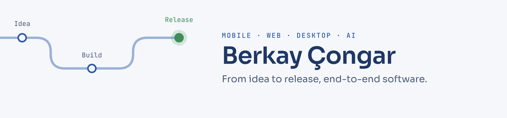
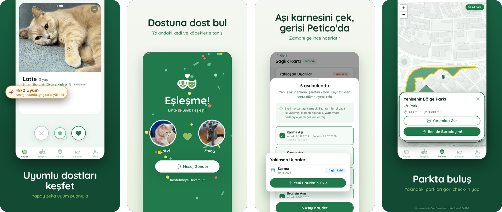

<picture>
  <source media="(prefers-color-scheme: dark)" srcset="assets/banner-dark.png">
  
</picture>

Software developer: mobile & web (React Native, Next.js, Supabase), plus C++/Qt desktop and computer vision · MSc student in Artificial Intelligence & Data Science at Sivas Cumhuriyet University · Sivas, Türkiye

I build products end to end and ship them: design, code, backend, store releases and the social media that follows.

## Featured work

### [Petico](https://github.com/berkaycongarr/petico-showcase) — AI-assisted pet matching app (solo developer, live)

Live on the [App Store](https://apps.apple.com/tr/app/petico-dost-bul/id6784002596) and [Google Play](https://play.google.com/store/apps/details?id=com.berkaycongar.petico) · [Download page](https://berkaycongarr.github.io/peticodostbul/)

React Native (Expo SDK 57), TypeScript, Expo Router · Supabase (PostgreSQL, Edge Functions) · LLM API

- AI compatibility score between pet profiles, with score caching and a per-user daily limit to keep API costs predictable
- Health card with AI vaccine-card reading and local reminders, adoption listings across 81 provinces, park map with check-ins, in-app messaging and push notifications
- Security and maintenance: Row Level Security on every table, server-side authorization for push notifications, distances computed on the server so exact user locations never reach the client, step-by-step upgrade from Expo SDK 54 to 57
- Resolved an App Store rejection (Guideline 1.2, user-generated content) with an EULA consent flow
- Selected for the Young Entrepreneurs Ideathon by Habitat Association and UNICEF Türkiye (Oct 2026); invited to Teknopark Istanbul's HASAT acceleration program

The source code is private. More screens are in the [showcase repository](https://github.com/berkaycongarr/petico-showcase), and I'm happy to walk through the code on a screen share.

### [Krater Kombinatı](https://github.com/berkaycongarr/krater-kombinati) — browser game for Kick streams · [▶ Play in browser](https://berkaycongarr.github.io/krater-kombinati/)

JavaScript, Canvas 2D · Node.js for balancing

- A five-minute factory race between a streamer and their chat: the streamer picks in secret, the chat votes 0–6, and both picks are revealed together
- Deterministic simulation core shared by the browser and Node.js; a rollout-based AI plays the bots, simulates the chat crowd and grades every decision
- 1920×1080 broadcast scene drawn with Canvas 2D, ready for OBS

### [Tube bending machine operator panel](https://github.com/berkaycongarr/tube-bending-hmi) — industrial HMI demo

C++, Qt 6 (QML), CMake · Windows

- Built for a pipe factory as a demo: homing, jog with software limits, bend-program editor, die library, semi/fully automatic production cycle, emergency stop and latched alarms with RESET
- The screen talks only to an `IMachine` interface, so the simulated PLC used in the demo can be swapped for a real PLC driver without touching UI code

### Client portal for a photography studio (delivered, in production)

Next.js, TypeScript, Tailwind CSS, Supabase, Google Drive API, Vercel

- Phone-number login and role-based access: each customer sees only their own albums
- Paginated listing and chunked ZIP downloads for 600+ photo albums, Range/206 video streaming
- Print-order system and admin panel for customers, galleries and orders

### License plate recognition for a garden gate

Python, YOLOv9, OCR, OpenCV, ESP32 · runs offline

- Reads number plates from a phone camera (YOLOv9 detection, OCR corrected with Turkish plate rules), locates the car with PnP and opens the gate through an ESP32 relay for allowed plates
- Chose the camera position and the minimum readable plate width (70 px) from on-site measurements; 87 automated tests

### Also

- AI internship: trained and compared 10 transfer-learning CNN models in PyTorch on a histology dataset
- Internship project "Hazır Ol": React + Express + MongoDB task app with JWT authentication

## Currently

- MSc in Artificial Intelligence & Data Science, Sivas Cumhuriyet University
- YÖK Digital University Platform, AI School: Machine Learning and Modern Software Development (2026–2027)

## Stack

TypeScript · JavaScript · Canvas 2D · React Native · Expo · React · Next.js · Node.js · Express · Supabase · PostgreSQL · MongoDB · Python · PyTorch · YOLOv9 · OpenCV · C++ · Qt 6 / QML · CMake · Git

## Contact

congarberkay@gmail.com · [LinkedIn](https://linkedin.com/in/berkaycongar)
